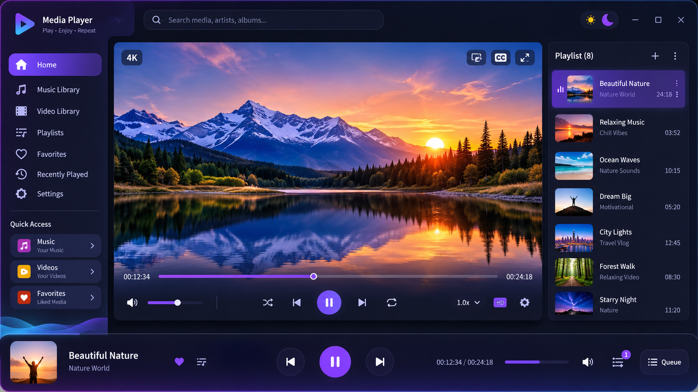

# Slide Up

<div align="center">


**A desktop media player built with Tauri 2, Rust, Vue 3, and a bundled libmpv engine.**

[](https://tauri.app/)
[](https://www.rust-lang.org/)
[](https://vuejs.org/)
[](https://www.typescriptlang.org/)
[](https://mpv.io/)
[](LICENSE)

[Download](#download) | [Features](#key-features) | [Architecture](#architecture) | [Keyboard Shortcuts](#keyboard-shortcuts) | [Installation](#installation-and-development) | [Contributing](#contributing) | [Support](#support)



</div>

---

## Download

| Platform | Download | Notes |
| :--- | :--- | :--- |
| Windows 10 / 11 (64-bit) | [Latest installer (EXE)](https://github.com/bhsorg/slide-up/releases/latest/download/Slide.Up-x64-setup.exe) · [MSI](https://github.com/bhsorg/slide-up/releases/latest/download/Slide.Up-x64.msi) | Direct download, automatic in-app updates, bundled libmpv |
| Android | [Android edition](https://hinditutorpoint.github.io/slideup/) | Separate mobile edition for phones and tablets |

All releases, installer assets, and changelogs are published on the [GitHub Releases page](https://github.com/bhsorg/slide-up/releases).

---

## Overview

Slide Up is a native desktop media player for audio and video. Instead of relying on browser HTML5 codecs, it embeds libmpv and renders video into a native Win32 child window. The Rust backend handles filesystem access, metadata extraction, library persistence, playlists, and media discovery, while Vue 3 renders the interface.

The application is currently Windows-focused. The native video surface and bundled `libmpv-2.dll` are Windows-specific, and macOS/Linux are not supported by the current release build.

---

## Key Features

### Audio Playback

- Broad format support for MP3, FLAC, WAV, AAC, OGG, Opus, M4A, ALAC, AIFF, and other formats through libmpv.
- Synchronized lyrics from LRCLIB with click-to-seek, title cleanup, transliteration-friendly matching, and an offline disk cache.
- Shuffle, repeat off/all/one, queue reordering, play-next, add-to-queue, and gapless track transitions.
- Artist information, favorites, recently played history, and a persistent SQLite-backed library.
- Optional detachable desktop player widget enabled from Settings: a compact always-on-top window with artwork, progress, playback controls, an expandable queue, and a real video preview that borrows the running mpv surface. Drag it anywhere or close it from the widget.

### Video Playback

- Native Win32 child-window rendering for video frames.
- Hardware decoding probes for D3D11VA, DXVA2, and NVDEC on Windows.
- Subtitle support for SRT, ASS, SSA, and WebVTT, including track switching and automatic detection.
- Frame stepping, aspect-ratio presets, audio track selection, and native screenshot capture.
- Fullscreen mode, picture-in-picture mode, and configurable video filters.

### File Associations and Single Instance

- Windows file associations for common audio and video extensions.
- "Open with" hands the file to the already running instance instead of starting a duplicate process.
- The first file starts playing; additional files are imported into the library.

### BitTorrent Parser and File Browser

- TypeScript bencode decoder for `.torrent` files with SHA-1 info hash calculation.
- File browser with filters for all files, audio, video, or specific extensions.
- Selective import of exact tracks, with running file and size counters.
- Companion artwork detection for sibling images and folder cover art.
- BEP 19 web seed and Archive.org stream resolution for direct HTTPS playback of torrent tracks.

### Online M3U / M3U8 Streaming

- Remote playlist fetching through the Rust backend to bypass browser CORS restrictions.
- Automatic categorization into audio or live video streams.
- URL sanitization for whitespace, encoded ampersands, and HTTPS redirects.
- Playlist export to `#EXTM3U` format and import from remote URLs or local files.

### AI Capabilities

- Local offline live captions using SenseVoice INT8 ONNX and Silero VAD, with a resumable model downloader in Settings.
- Real-time FSRCNNX x2 shader enhancement through the mpv rendering pipeline.
- Offline Real-ESRGAN x4 batch video upscaling using ONNX Runtime and ffmpeg frame extraction.

---

## Architecture

```text
slide-up/
├── src/                          # Frontend: Vue 3, TypeScript, Tailwind CSS
│   ├── components/               # AudioPlayer, VideoPlayer, MediaGrid, PlaybackDock, PlayerWidget
│   ├── composables/              # useLyrics, useArtistBio, useToast, useSubtitleAvailability
│   ├── services/                 # tauri.ts IPC bridge, lyrics and artist services
│   ├── stores/                   # Pinia stores: player, library, playlists, settings
│   ├── types/                    # TypeScript interfaces
│   ├── utils/                    # torrent.ts, m3u.ts
│   └── views/                    # Home, Playlists, Favorites, Recent, Settings, Live TV
│
└── src-tauri/                    # Backend: Rust, Tauri 2, SQLite, mpv integration
    ├── src/
    │   ├── commands/             # IPC command handlers
    │   ├── db/                   # SQLite repository and migrations
    │   ├── mpv/                  # libmpv dynamic loader and Win32 embedding
    │   ├── model_manager.rs      # SenseVoice model lifecycle
    │   ├── upscaler_manager.rs   # FSRCNNX and Real-ESRGAN pipeline
    │   ├── widget.rs             # Detachable widget window lifecycle and docking
    │   └── lib.rs                # Application entry point and plugin setup
    ├── tauri.conf.json           # Window definitions, including the lazy widget window
    ├── capabilities/             # Per-window Tauri permissions, including widget.json
    ├── binaries/                 # onnxruntime.dll
    └── resources/                # libmpv-2.dll, vulkan-1.dll
```

---

## Keyboard Shortcuts

| Shortcut | Action |
| :--- | :--- |
| `Space` | Play / Pause |
| `Left Arrow` / `Right Arrow` | Seek backward / forward 5 seconds |
| `Up Arrow` / `Down Arrow` | Volume up / down |
| `M` | Mute / Unmute |
| `F` | Toggle fullscreen |
| `Esc` | Exit fullscreen |
| `N` / `P` | Next / Previous track |
| `Ctrl + O` | Open media files |
| `Ctrl + Shift + O` | Open a media folder |

Shortcuts can be customized in Settings.

---

## Installation and Development

### Prerequisites

- Node.js 18 or newer.
- A stable Rust toolchain with Edition 2024 support.
- Windows 10 / 11 x64 for the current release build, including native video embedding.

### Setup

```bash
git clone https://github.com/bhsorg/slide-up.git
cd slide-up
npm install
```

Verify that the native binaries are present before building:

```text
src-tauri/resources/libmpv-2.dll
src-tauri/resources/vulkan-1.dll
src-tauri/binaries/onnxruntime.dll
```

### Development

```bash
npm run tauri dev
```

### Production build

```bash
npm run tauri build
```

Release builds that publish updater artifacts require `TAURI_SIGNING_PRIVATE_KEY` in the environment, and optionally `TAURI_SIGNING_PRIVATE_KEY_PASSWORD`. The public key configured in `tauri.conf.json` must match the signing key.

---

## Security, Privacy and License

- Local library scanning, metadata extraction, and AI inference run on your machine.
- Online features such as lyrics lookup, M3U streams, and torrent web seeds are opt-in.
- Network requests are handled by the Rust backend; the webview does not receive unrestricted filesystem access.
- No user tracking or behavioral telemetry.
- Project source: [https://github.com/bhsorg/slide-up](https://github.com/bhsorg/slide-up)
- Website / blog: [https://bloghindisupport.com](https://bloghindisupport.com)
- Android edition: [https://github.com/hinditutorpoint/slideup](https://github.com/hinditutorpoint/slideup)
- License: GNU General Public License v3.0. Modified distributions and forks must remain open source under the same terms.

---

## Contributing

Contributions are welcome through bug reports, feature proposals, documentation improvements, and pull requests.

1. Fork the repository.
2. Create a feature branch:

   ```bash
   git checkout -b feature/your-feature
   ```

3. Commit your changes:

   ```bash
   git commit -m "feat: describe your change"
   ```

4. Push the branch:

   ```bash
   git push origin feature/your-feature
   ```

5. Open a pull request with a clear description of the change.

Please use the [GitHub issue tracker](https://github.com/bhsorg/slide-up/issues) for bugs and feature requests.

---

## Support

Slide Up is free and open source. If it is useful to you and you want to support ongoing development, you can use the link below.

[Buy Me A Coffee](https://buymeacoffee.com/hinditutorpoint)

---

<div align="center">

Maintained by [bhsorg](https://bloghindisupport.com) | [Desktop source](https://github.com/bhsorg/slide-up) | [Android edition](https://hinditutorpoint.github.io/slideup/)

</div>
